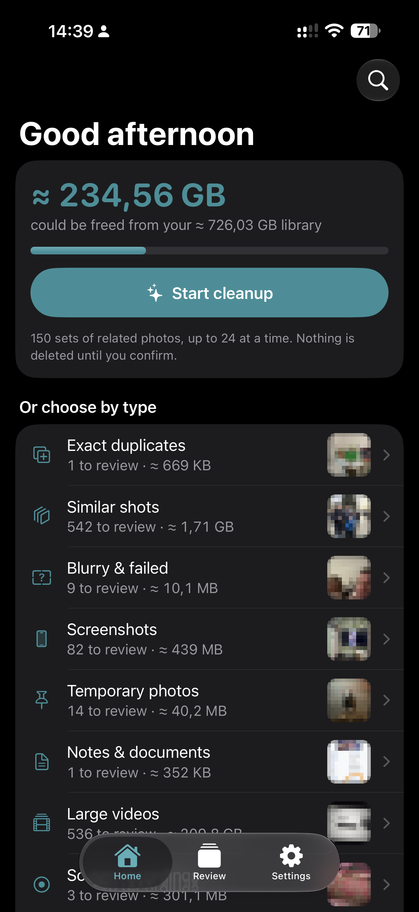
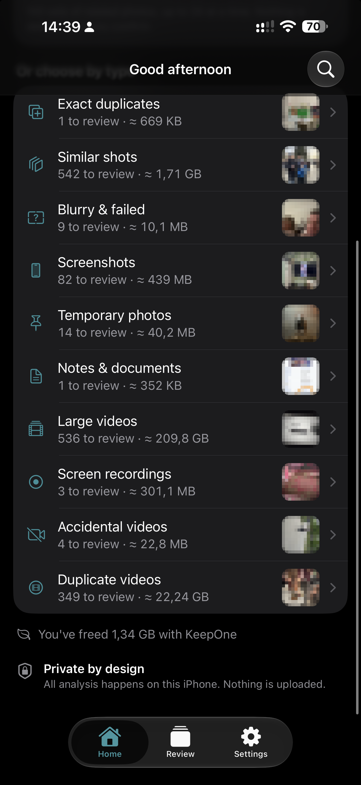
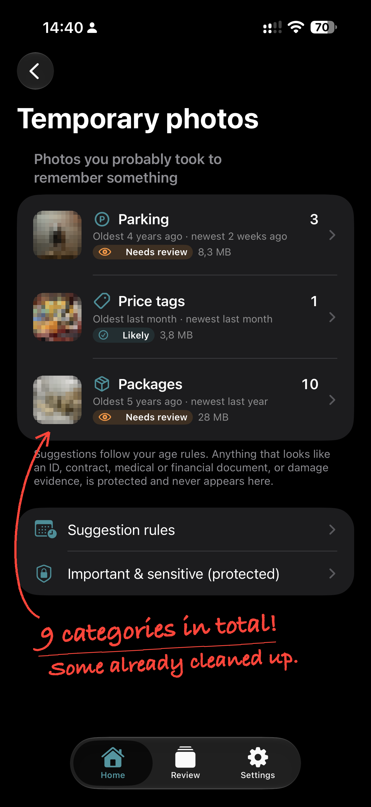

# KeepOne

**Keep your best photos. Free up space on your iPhone.**

KeepOne finds duplicate photos, picks the best shot from similar ones, and helps you
clear blurry pictures, old screenshots, temporary photos and unwanted videos.

**19 cleanup categories**, including 9 types of temporary photos: receipts, tickets, labels and more.

🔒 Photos are analyzed on your iPhone. No account, uploads or tracking.

🫶 You choose what goes. Nothing is deleted without your final confirmation.

| Free up space | Choose what to review | Clear temporary photos |
| :---: | :---: | :---: |
|  |  |  |

*Real iPhone screenshots with personal photo previews pixelated. Empty categories disappear after cleanup.*

## A little cleanup, one step at a time

1. **Scan** your library and see how much space you could free.
2. **Review** small sets of related photos. Keep, skip or change any suggestion.
3. **Confirm** your selection in Trash. Deleted items go to Recently Deleted in Photos.

## Try it on your iPhone

Requires **iOS 18+** and **Xcode 27** on a Mac.

Open `KeepOne.xcodeproj`, choose your Apple development team and iPhone, then press **⌘R**.
Allow Photos access and keep KeepOne open for the first scan.

[Setup guide →](docs/SETUP.md)

For developers: [Architecture](docs/ARCHITECTURE.md) · [Tests](docs/TESTING.md) · [Model](docs/MODELS.md) · [Calibration](docs/CALIBRATION.md)

The bundled model is for non-commercial research use under the [Apple ML Research Model License](docs/licenses/MobileCLIP2-LICENSE.txt).
